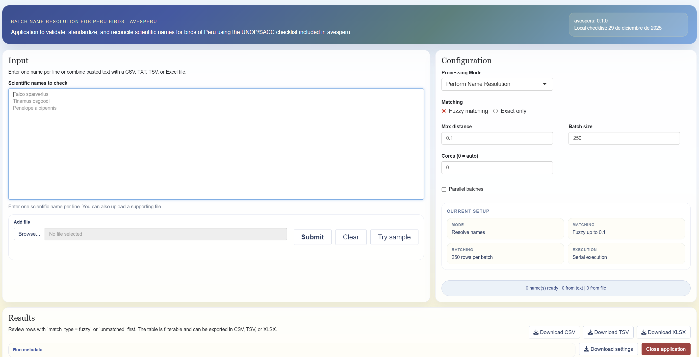

<!-- README.md is generated from README.Rmd. Please edit that file -->

```{r, include = FALSE}
knitr::opts_chunk$set(collapse = TRUE, comment = "#>", fig.path = "man/figures/README-", out.width = "100%")
```

# avesperu <a href="https://github.com/PaulESantos/avesperu"></a>

<!-- badges: start -->
[](https://lifecycle.r-lib.org/articles/stages.html#stable)
[](https://CRAN.R-project.org/package=avesperu)
[](https://github.com/PaulESantos/avesperu/actions/workflows/R-CMD-check.yaml)
[](https://app.codecov.io/gh/PaulESantos/avesperu)
[](https://CRAN.R-project.org/package=avesperu)
<!-- badges: end -->

`avesperu` gives R users a local, versioned checklist of the birds of Peru and tools to find and reconcile scientific names. It supports reproducible work on field records, biodiversity databases, and taxonomic reviews without requiring an internet connection for ordinary searches.

The bundled `aves_peru_2026_v1` checklist contains 1,925 species and follows the Unión de Ornitólogos del Perú (UNOP) list dated 23 March 2026. It combines the checklist with exact and approximate matching for practical data cleaning.

## Get started

Install the released package from CRAN:

```r
install.packages("avesperu")
```

Or install the development version:

```r
pak::pak("PaulESantos/avesperu")
```

Search a short list of submitted names:

```{r}
library(avesperu)
result <- search_avesperu(
  c("Falco sparverius", "Tinamus osgoodi"),
  return_details = TRUE
)
result[, c("name_submitted", "accepted_name", "status", "dist")]
```

The result preserves the submitted name and returns the accepted name, status, and taxonomy. For a visual workflow, launch the [interactive Shiny app](https://paulefrensa.shinyapps.io/avesperu/):

```r
run_avesperu_app()
```



## What you can do

- **Search the current Peru checklist** with `search_avesperu()` and retrieve taxonomic details for one name or a vector of names.
- **Reconcile spelling variants** with controlled approximate matching; see the [approximate matching guide](https://paulesantos.github.io/avesperu/articles/coincidencia-aproximada.html).
- **Validate field-data workflows** while keeping submitted values and review information; see [advanced use](https://paulesantos.github.io/avesperu/articles/uso-avanzado.html).
- **Compare checklist releases** in the existing [2025–2026 comparison](https://paulesantos.github.io/avesperu/articles/comparison.html).
- **Review and export batches interactively** with the local Shiny application.

## Scope and source

`avesperu` covers the bird species checklist of Peru distributed by UNOP. It is not an authority for records outside Peru, and approximate matches should be reviewed before being accepted in a dataset. Tied candidates and qualified or hybrid names are deliberately flagged for review rather than silently resolved.

The source is the [Lista de las aves del Perú / List of the Birds of Peru](https://sites.google.com/site/boletinunop/checklist), maintained by UNOP. This release is based on version 23-03-2026; inspect the bundled data directly with `aves_peru_2026_v1`, or run `unop_check_update()` when you intentionally want to compare the local date with the online source.

## Learn more

- [Package website](https://paulesantos.github.io/avesperu/)
- [Advanced use](https://paulesantos.github.io/avesperu/articles/uso-avanzado.html)
- [Approximate matching](https://paulesantos.github.io/avesperu/articles/coincidencia-aproximada.html)
- [Report an issue](https://github.com/PaulESantos/avesperu/issues)

## Citation and contact

Use `citation("avesperu")` to obtain the current package and checklist citations. Please cite both the package and the UNOP checklist when it informs your work. The package is released under the MIT license; questions and bug reports are welcome through the [issue tracker](https://github.com/PaulESantos/avesperu/issues).
